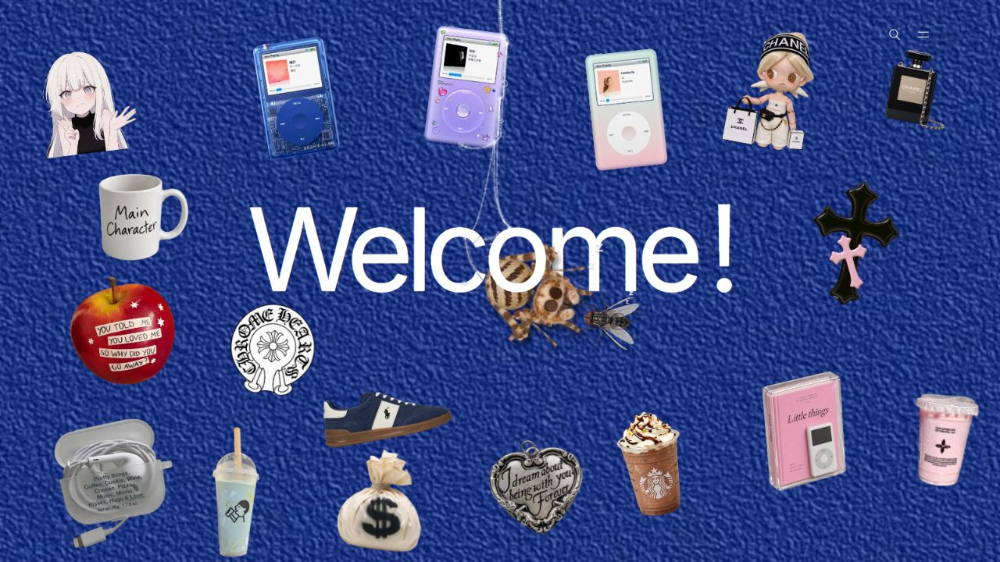
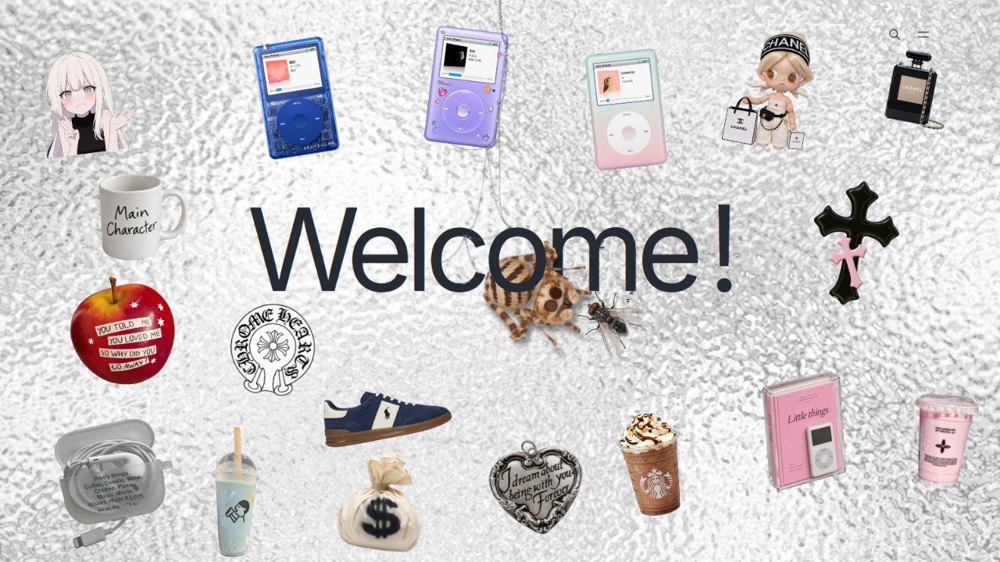
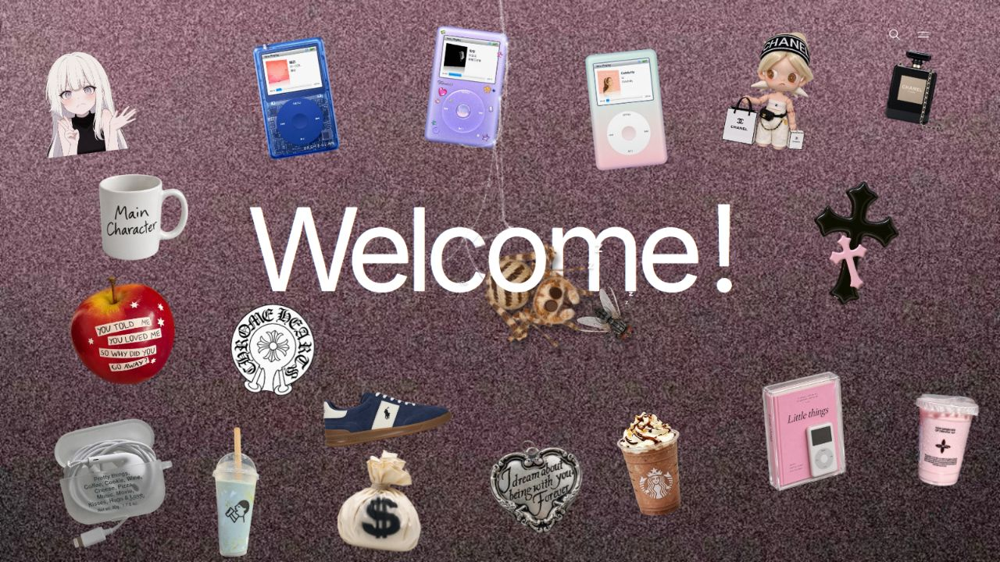

# MovingSpider

一个可以被探索、触碰和慢慢织满蛛丝的全屏收藏柜。18 件透明物品围绕 `Welcome！` 散落在画面中；一只用照片切片驱动的跳蛛追逐苍蝇光标，在文字和物件之间牵线，扑跳、捕捉、打盹，再被你的下一次移动惊醒。

页面使用原生 HTML、CSS 和 JavaScript。全部动画共用 **一个可见的 Canvas 2D**，图像切片、轮廓遮罩和阴影合成使用离屏 canvas。构建后的 HTML 内嵌图片、背景、Inter 字体和脚本，可以直接打开，也可以部署到普通静态网站。

## 三种背景预览

三个版本共用同一组物品、布局和交互。背景采用提供的原始图片，仅进行 WebP 编码和等比例缩放，保留原有纹理、色彩和图像内容，不重绘或改色。页面通过 `background-size: cover` 与居中定位适配不同视口。

| 主题 | 视觉特征 | 文字与图标 | 独立页面 | 地址参数 |
| --- | --- | --- | --- | --- |
| **Blue**，默认 | 蓝色织物纹理，呈现柔软的材料感 | 白色 | [previews/blue.html](./previews/blue.html) | `?theme=blue` |
| **Silver** | 磨砂银色纹理，突出金属、玻璃与饰品细节 | 深色，保证浅背景上的可读性 | [previews/silver.html](./previews/silver.html) | `?theme=silver` |
| **Rose** | 粉色至黑色的颗粒渐变，形成由明到暗的背景 | 白色 | [previews/rose.html](./previews/rose.html) | `?theme=rose` |

也可以使用 `?theme=original`，切回纯电蓝 `#1129e2` 背景。

### Blue · 蓝色织物



### Silver · 磨砂银色



### Rose · 粉黑颗粒渐变



截图展示静态构图；蛛丝会随实际游走路径生成，露珠、物件晃动和蜘蛛状态也会随交互变化。

## 打开与运行

### 直接打开成品

下载仓库后，用浏览器打开 [index.html](./index.html)。默认加载 Blue 主题。三个 `previews/*.html` 也是完整独立文件，可以单独复制、发送和打开。

成品运行不需要 Node.js、依赖安装、CDN、API Key 或后端服务。GitHub 上的 HTML 文件页展示源码；实际体验请下载后打开，或使用静态站点托管。

### 修改源码后构建

在项目根目录执行：

```sh
node build.mjs
```

构建脚本仅使用 Node.js 内置模块，不需要执行 `npm install`。它读取页面模板、主题与交互脚本、收藏品清单和本地素材，把资源转成 data URI 后写入独立 HTML。

如需通过 HTTP 检查页面，也可以使用 Python 自带的静态服务器：

```sh
python -m http.server 8080
```

随后打开 [本地预览](http://localhost:8080/)。切换背景时，在地址末尾加入对应参数，例如 `http://localhost:8080/?theme=silver`。

## 操作说明

| 操作 | 页面反应 |
| --- | --- |
| 移动鼠标 | 苍蝇跟随指针，蜘蛛转向并追逐，在沿途物件和文字的轮廓之间织网。 |
| 在场景中单击 | 蜘蛛扑向苍蝇；距离合适时会捕捉并逐渐缠上丝茧，约 3–4.2 秒后苍蝇挣脱。 |
| 停止移动 | 苍蝇逐渐落下；蜘蛛站稳后切换休息面孔、眨眼，持续休息约 8 秒后进入睡眠。 |
| 移动指针唤醒 | 深度休息中的蜘蛛做一次短促的惊醒跳跃。 |
| `Delete` / `Backspace` | 抖落蛛网和露珠，并从蜘蛛的吐丝点重新开始牵线；输入框内仍保持正常编辑行为。 |
| 触屏双击 | 把苍蝇移到触点并触发扑跳。 |
| 触屏按住约 650 毫秒 | 清除蛛网；支持振动的设备会尝试给出短促反馈。 |
| 右上角菜单图标 | 打开包含全部 18 件物品的图片收藏柜。 |
| 搜索图标 / `Ctrl+K` / `⌘K` | 打开搜索，在本地按名称和关键词筛选图片。 |
| `Esc` / 关闭图标 / 点击抽屉外部 | 关闭收藏柜，并将焦点还给打开它的控件。 |

鼠标位于按钮、输入框或抽屉内时，苍蝇会淡出，控件保持正常的点击和输入行为。离开窗口后苍蝇隐藏，蜘蛛停止追逐。

主场景的界面文字仅保留 `Welcome！`。物品上的品牌、刻字和印花是图片本身的内容。收藏柜使用图片展示，名称仍通过图片替代文本和无障碍标签提供。页面没有音频播放器。

## 设计原则

### 1. 用物件建立叙事

物品以透明剪贴图散布在画面中，各自保留摄影、插画、包装和材质的差异。它们没有统一卡片底色，也不被整理成首页栅格；轻微的初始旋转和不同尺度，让收藏柜保留随手放置的感觉。需要逐件查找时，再进入规则排列的图片抽屉。

### 2. 保留一个明确的视觉中心

中央 `Welcome！` 使用大字号和紧凑字距，提供一眼可辨的视觉中心。物品围绕字标分布，顶部和底部承载更多细节，中部为蜘蛛运动及丝线连接保留空间。手机布局单独安排每件物品的位置和宽度，避免把桌面构图简单压缩成一张小图。

### 3. 通过遮挡建立层次

页面保留三个主要层次：DOM 物件与主字标、Canvas 动画、只显示字母 `o` 的前景字标副本。蜘蛛可以从 `o` 后面经过，同时出现在其他字母前面。这个局部遮挡关系让文字参与场景，而不只是背景装饰。

### 4. 让背景保留自己的材料感

Blue、Silver、Rose 的区别来自背景图片本身。织物、磨砂金属和颗粒渐变提供不同的材料氛围；物品仍使用相同照片和运动逻辑。Silver 使用深色字标与界面图标，其余主题使用白色，保持主体和背景之间的辨识度。

### 5. 让交互留下可见的痕迹

蜘蛛的路线会改变蛛网。丝线落在真实文字和图片轮廓上，脚步、扑跳和指针经过都会引起振动。露珠可以沿线滑动、坠落，最后停在物体表面。用户每次移动留下的痕迹成为构图的一部分。

### 6. 让运动有起伏

追逐使用带缓动的速度和转向；腿按交替组迈步；扑跳通过缩放与投影表现高度。运动减慢后，表情、呼吸、眨眼和收腿继续传达状态。停留本身也能触发反馈，页面不要求持续点击才能有变化。

## 元素清单

主场景包含 **18 件收藏物品：2 件基础物品 + 16 件清单物品**。蜘蛛、苍蝇、丝线、背景、字标和界面图标不计入此数量。

清单物品的名称与 [assets/collection.json](./assets/collection.json) 一致。基础两件由页面直接声明，搜索使用其图片 `alt` 文本。

| # | 类型 | 名称 / 当前搜索名称 | DOM ID | 素材 |
| --- | --- | --- | --- | --- |
| 1 | 基础 | A ceramic mug with Main Character written on it | `object-mug` | `assets/mug.webp` |
| 2 | 基础 | A pink book and an iPod in a transparent glass sleeve | `object-book` | `assets/book.webp` |
| 3 | 清单 | 透明蓝色 iPod | `object-ipod-blue` | `assets/cutouts/ipod-blue.webp` |
| 4 | 清单 | 紫色宝石 iPod | `object-ipod-purple` | `assets/cutouts/ipod-purple.webp` |
| 5 | 清单 | 珠光渐变 iPod | `object-ipod-pearl` | `assets/cutouts/ipod-pearl.webp` |
| 6 | 清单 | 白发女孩插画 | `object-anime` | `assets/cutouts/anime.webp` |
| 7 | 清单 | 香奈儿穿搭玩偶 | `object-doll` | `assets/cutouts/doll.webp` |
| 8 | 清单 | 深蓝色 Polo 运动鞋 | `object-sneaker` | `assets/cutouts/sneaker.webp` |
| 9 | 清单 | 蓝色冰沙饮品 | `object-blue-drink` | `assets/cutouts/blue-drink.webp` |
| 10 | 清单 | 黑色香水瓶链条包 | `object-perfume` | `assets/cutouts/perfume.webp` |
| 11 | 清单 | 巧克力奶油星冰乐 | `object-frappe` | `assets/cutouts/frappe.webp` |
| 12 | 清单 | 美金符号钱袋 | `object-money-bag` | `assets/cutouts/money-bag.webp` |
| 13 | 清单 | 耳机收纳盒 | `object-earbuds` | `assets/cutouts/earbuds.webp` |
| 14 | 清单 | 粉色冰饮 | `object-pink-drink` | `assets/cutouts/pink-drink.webp` |
| 15 | 清单 | 贴纸红苹果 | `object-apple` | `assets/cutouts/apple.webp` |
| 16 | 清单 | 黑粉双色十字饰品 | `object-crosses` | `assets/cutouts/crosses.webp` |
| 17 | 清单 | 银色心形挂件 | `object-silver-heart` | `assets/cutouts/silver-heart.webp` |
| 18 | 清单 | Chrome Hearts 圆形徽标 | `object-chrome-emblem` | `assets/cutouts/chrome-emblem.webp` |

清单物品包含中文和英文搜索关键词，例如 `心形`、`silver`、`ipod`、`奶茶`、`sticker`。菜单和搜索直接读取场景中 `.frame img.object` 的数据，因此物品清单和抽屉内容使用同一套来源。

其他画面元素的职责如下：

| 元素 | 实现与作用 |
| --- | --- |
| `Welcome！` | DOM 文本，使用内嵌 Inter Latin 字体及系统字体回退；保留全角感叹号。 |
| 前景 `o` | 同一字标的透明副本，仅 `o` 可见，用于遮挡蜘蛛和丝线。 |
| 搜索、菜单、关闭图标 | 内嵌 SVG，保留按钮语义、焦点样式和无障碍名称。 |
| 蜘蛛 | 从照片提取腹部、头部和八条腿，通过 IK 驱动。 |
| 休息面孔 | 独立照片与行走头部交叉淡入淡出，叠加眼睑动画。 |
| 苍蝇光标 | 照片分离身体和两翼，叠加飞行抖动、扇翅、落地与捕捉状态。 |
| 蛛丝与露珠 | 实时生成的绳索、纤维、玻璃珠精灵和遮罩阴影。 |

## 动画与渲染实现

### 一个可见画布，多张离屏画布

页面只向 DOM 挂载一个可见 `<canvas>`。其余 canvas 通过 `document.createElement('canvas')` 创建，作为内存中的工作表面，用于照片切片、精灵合成、字体轮廓、玻璃露珠和阴影遮罩，不作为额外图层插入页面。

每帧先更新苍蝇、物件晃动、蜘蛛运动与休息状态，再推进蛛丝物理。绘制依次包含遮罩阴影、丝线与露珠、蜘蛛、睡眠符号以及苍蝇和丝茧。

### 照片切片与八腿 IK

[src/spider.js](./src/spider.js) 使用 1254 单位的身体坐标系。`limbPoints` 定义运动骨架，`photoLimbs` 定义照片采样位置，两者分开维护，让照片纹理可以映射到稳定的运动比例。

腹部和头部由软边椭圆遮罩提取。每条腿沿“髋关节 → 膝关节 → 足端”的折线进行双线性采样，生成宽 92 单位的直条纹理，并在边缘淡出透明度。绘制时再分别把股节和胫节纹理映射回两个骨段，接缝处保留轻微重叠。

足端在落地时保留世界坐标，身体移动后通过两骨骼余弦定理计算膝关节。八条腿分成两个交替组，足端距离目标过远、过度伸展或前脚落在身体后方时触发迈步。迈步时长随速度在约 0.055–0.15 秒之间变化，并添加抬脚弧线。

### 追逐、扑跳与休息

蜘蛛先沿顶部丝线落下：等待约 3 秒后，用约 2.3 秒完成下降，再经过阻尼回弹落地。追逐速度和转向使用指数缓动，腹部随转向产生轻微摆动。

扑跳按苍蝇位置计算目标，让口部接近苍蝇，同时限制单次位移。跳跃高度影响精灵缩放、阴影偏移和模糊，落地则触发压缩、丝线振动以及附近物件的旋转。捕捉成功后，用渐进椭圆和细纤维绘制丝茧；苍蝇挣脱后产生短暂回弹，并可被再次捕捉。

安静时蜘蛛切换到休息面孔。眨眼由采样头部颜色绘制的眼睑覆盖完成；休息超过 8 秒后，用约 1.6 秒进入睡眠，腿部收拢到约 62% 伸展，呼吸变慢，眼睛保持闭合。深度睡眠时再次移动指针，会触发约 0.3 秒的惊醒跳跃。

### 轮廓锚点与 Verlet 蛛丝

[src/silk.js](./src/silk.js) 从带有 `data-web-anchor` 的元素建立附着点：

- **文字**：通过 DOM Range 读取实际排版中的字形位置，再绘制到离屏画布采样边缘。
- **透明图片**：按 alpha 边缘采样，保留主体的真实外轮廓。
- **SVG 图标**：序列化并栅格化图标轮廓。
- **盒状元素**：可通过 `data-web-shape="box"` 使用圆角矩形轮廓。

采样点按约 7px 的网格稀疏化，再用空间索引查询附近锚点。蜘蛛吐丝点必须实际移动一段距离后才能再次附着，防止静止时在相邻轮廓间反复连线。

每条丝线包含 **12 段、13 个节点**，使用 Verlet 积分，阻尼为 `0.975`，叠加重力、缓慢变化的风和指针推动。每帧进行四轮长度约束，并把两端固定在锚点上。略大于直线距离的静长让丝线自然下垂。主线附着后，还可能生成连接旧锚点的径向线和较近物件之间的辅助线。

丝线的外观由细主线、柔光、偏色高光、两条摆动副纤维、微小毛丝、局部绒团和移动闪光叠加而成。较老的丝线在约 90 秒内逐渐降到一半不透明度。

### 只落在物件上的阴影

文字和图片的轮廓同时组成一张接收阴影的遮罩。蛛网先在离屏画布上绘制偏移、模糊的阴影，再通过 `destination-in` 与轮廓遮罩相交，最后合成到主 canvas。

因此丝线的影子会落在字母和收藏物件上，背景纹理保持自身的观感。蜘蛛和苍蝇则分别使用与高度、落地状态相关的动态投影。

### 露珠与物件反馈

露珠使用带透明边缘、暖色焦散和白色高光的玻璃珠精灵。振动可能让它们开始滑动；滑动速度由线段斜率推动。离开丝线后，露珠受重力影响坠落，并通过轮廓遮罩检测是否撞到物件，形成压扁的水珠。

物件通过 CSS 独立 `rotate` 和 `translate` 响应蜘蛛经过与落地。清单中的初始倾角与交互产生的动态倾角分开保存；碰撞范围按当前旋转与位移计算。运动停止后重新采样轮廓，使后续丝线附着点与画面一致。

## 响应式与运行开销

桌面使用 2000×1125 的设计坐标比例，以 `--u` 同时约束物件尺寸和文字大小；位置使用相对视口百分比。竖屏使用独立的 `mobileX`、`mobileY`、`mobileWidth`，并同时限制宽度和高度缩放。短横屏保持整屏收藏布局，不需要滚动主场景。

蜘蛛本身使用独立于物品布局的缩放规则，避免在窄屏中完全失去可辨识的腿部动作。画布由 `ResizeObserver` 同步尺寸，设备像素比上限为 2。

运行时还采用以下限制：

- 单帧物理步长最多 `0.033` 秒；页面不可见时暂停状态推进。
- 最多保留约 140 条绳索和 140 个结点，较早的记录逐步移出。
- 表面水珠最多 400 个，空中水滴最多 800 个。
- 毛丝根据总量调整绘制步进，触屏使用更低的毛丝密度与绘制预算。
- 字体和图像就绪、窗口改变或物件停止晃动后再重采样轮廓，避免每帧重建全页遮罩。

页面读取 `prefers-reduced-motion`：开启时跳过蜘蛛下落入场，并关闭苍蝇的随机飞行抖动。追逐、扑跳和丝线交互仍然保留。

## 项目结构

```text
MovingSpider/
├── index.html                 # 默认 Blue 主题的独立成品
├── previews/
│   ├── silver.html            # Silver 独立成品
│   ├── rose.html              # Rose 独立成品
│   └── blue.html              # Blue 独立成品
├── docs/previews/             # README 中的主题截图
├── src/
│   ├── page.html              # 页面模板、布局、主题与响应式样式
│   ├── theme.js               # URL 主题选择、默认主题与主题接口
│   ├── ui.js                  # 图片抽屉、键盘入口与关键词搜索
│   ├── spider.js              # 照片骨架、步态、苍蝇、扑跳与休息
│   └── silk.js                # 轮廓、绳索、阴影、纤维与露珠
├── assets/
│   ├── collection.json        # 16 件清单物品的配置
│   ├── backgrounds/           # 三张背景 WebP 与编码记录
│   ├── cutouts/               # 透明 WebP 与处理来源记录
│   ├── inter-latin.woff2      # 内嵌字体源文件
│   ├── OFL-Inter.txt          # Inter 字体许可原文
│   ├── prompts.json          # 基础生成素材提示词
│   ├── manifest.json         # 基础素材尺寸与标定记录
│   └── *.webp                # 马克杯、书本、蜘蛛、休息面孔与苍蝇
├── build.mjs                  # 零第三方依赖的静态打包脚本
└── README.md
```

## 调整物品与继续开发

### 更改位置、尺寸和检索词

修改 [assets/collection.json](./assets/collection.json) 中对应项，然后运行 `node build.mjs`：

```json
{
  "id": "silver-heart",
  "file": "silver-heart.webp",
  "name": "银色心形挂件",
  "keywords": "银色 心形 挂件 刻字 heart silver pendant forever",
  "x": 49,
  "y": 78,
  "width": 190,
  "tilt": -9,
  "mobileX": 40,
  "mobileY": 86,
  "mobileWidth": 95
}
```

`x`、`y` 和移动端坐标表示视口百分比；`width`、`mobileWidth` 是乘以 `--u` 的设计单位；`tilt` 是初始角度。`id` 应保持唯一，`file` 指向 `assets/cutouts/` 中的透明 WebP。

构建器会生成图片元素、数据属性和内嵌资源。新图自动参与图库检索、物件晃动和轮廓采样。增加物品后，应同时检查图片的实际长宽比、旋转后的边界及手机构图，并更新 README 清单。

### 调整主题

[src/theme.js](./src/theme.js) 先读取有效的 `theme` URL 参数，再读取页面的默认主题。`index.html` 默认使用 Blue，独立预览文件各自带有对应默认值。所有主题背景均内嵌于成品，切换时无需再次获取文件。

也可以通过控制台或集成代码切换：

```js
window.FoundTheme.set('silver');
window.FoundTheme.current;
```

可用值为 `silver`、`rose`、`blue` 和 `original`。[背景素材记录](./assets/backgrounds/manifest.json) 列出原始尺寸、交付尺寸、编码与来源校验值。当前交付背景最长边不超过 1800px，采用 WebP quality 92 编码。公开仓库提供可直接重建页面的优化素材；背景原始 JPG 和制作中间文件保留在本地制作目录，不随公开包上传。

### 更换蜘蛛或苍蝇照片

替换图片后，需要重新标定照片空间中的身体、腿部、眼睛和翅膀位置。仅替换文件而沿用原来的采样坐标，会把不对应的部位切入精灵。运动骨架和照片采样坐标分别位于 `limbPoints`、`photoLimbs`，头部、眼睑和翅膀也有独立映射。

### 调试与验证

构建脚本检查素材是否存在、模板占位符是否完整替换、内嵌 JavaScript 语法、可见 canvas 数量、照片嵌入数量以及外部脚本/图片引用。

在 URL 中加入 `?qa`，或与主题组合为 `?theme=silver&qa`，可以让 `#web-canvas` 的 `data-state` 属性定期写入诊断快照。浏览器控制台也可以读取：

```js
window.foundDebug.state
```

快照包含画布尺寸、缩放、帧数、蜘蛛位置与睡眠状态、扑跳/惊醒计数、苍蝇捕捉/释放计数，以及绳索、露珠和锚点数量。诊断内容不会显示在普通页面上。

发布前可按以下路径检查：

1. 分别打开三个主题，确认 18 件物品、字标和两枚导航图标均成功渲染。
2. 检查桌面、窄竖屏和短横屏，留意图片旋转后的边界。
3. 打开菜单，确认 18 个图片条目；搜索 `心形`、`ipod` 或其他关键词。
4. 移动、扑跳并等待苍蝇挣脱，再重复捕捉，确认状态能够循环。
5. 停留足够时间，观察收腿、闭眼和睡眠，再移动指针观察惊醒。
6. 清网并继续移动，确认旧线退场、新线从吐丝点重新生成；搜索输入框内的退格仍能删除文字。
7. 在目标触屏设备上检查双击与长按；振动支持由设备和浏览器决定。

## 素材来源与使用范围

基础马克杯、书本以及蜘蛛、休息面孔和苍蝇素材采用 Imagegen 生成，提示词与尺寸记录见 [assets/prompts.json](./assets/prompts.json) 和 [assets/manifest.json](./assets/manifest.json)。

16 件清单物品来自提供的照片或插画。透明版本使用内置 Imagegen 的**原图编辑与背景提取**流程处理。公开仓库包含用于网页交付的透明 WebP 和处理记录；原始输入与中间 PNG 留在本地制作目录。生成式背景处理可能带来局部像素差异；它们并非无损抠图的承诺。具体提示词与输入对应关系记录在 `assets/cutouts/provenance-*.json` 中，公开记录已去除本机绝对路径。圆形徽标保留图案内部的白色贴纸底色，深色金属凹槽、印字和品牌细节属于主体。

三张主题背景使用提供的图像内容，编码为网页资源后嵌入成品。字体来自 Inter；字体、照片、插画、商标、包装图案和其他第三方内容各自保留其对应的权利与许可。仓库公开不等于这些图像获得统一的开源授权，也不表示相关品牌参与或认可本项目。代码与素材的可复用范围以仓库明确列出的授权及各素材原有许可为准。

Inter 使用 SIL Open Font License 1.1，许可原文见 [assets/OFL-Inter.txt](./assets/OFL-Inter.txt)。其他说明见 [THIRD_PARTY_NOTICES.md](./THIRD_PARTY_NOTICES.md)。
